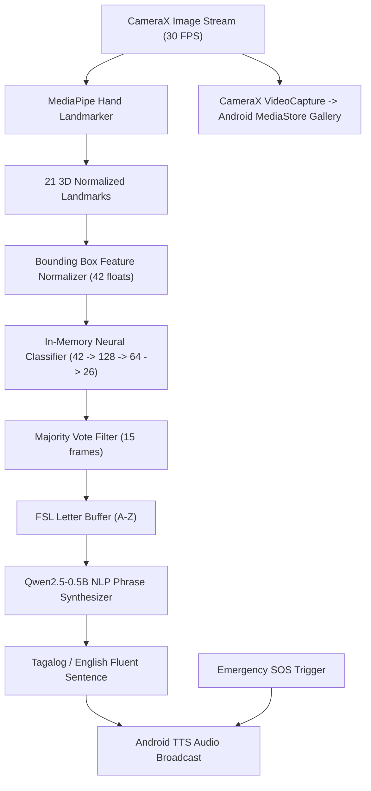

# iWani — Project Nexus
### On-Device Filipino Sign Language (FSL) Translation & Emergency Assistance System

[](https://developer.android.com/)
[](https://kotlinlang.org/)
[](https://developer.android.com/jetpack/compose)
[](https://developers.google.com/mediapipe)
[](#machine-learning-pipeline)
[](https://www.icct.edu.ph/)

> **Project Nexus** is an accessible on-device assistive technology designed for Deaf, Hard of Hearing (HOH), and speech-impaired Filipinos. Developed by Computer Engineering students of **ICCT Colleges Foundation Inc.**, **iWani** bridges communication barriers through real-time 3D hand tracking, neural gesture recognition, bilingual Tagalog/English translation, and one-tap emergency voice broadcast.

---

## 📑 Table of Contents
1. [Key Features](#key-features)
2. [Application Architecture](#application-architecture)
3. [Machine Learning & Vision Pipeline](#machine-learning--vision-pipeline)
4. [NLP Engine (Qwen2.5-0.5B-Instruct)](#nlp-engine-qwen25-05b-instruct)
5. [Repository Structure](#repository-structure)
6. [Prerequisites & Build Instructions](#prerequisites--build-instructions)
7. [Team Hierarchy & Credits](#team-hierarchy--credits)
8. [License & Acknowledgments](#license--acknowledgments)

---

## 🚀 Key Features

### 1. Real-Time FSL 26-Letter Alphabet Classifier
* **MediaPipe 21-Joint 3D Hand Landmarks**: High-frame-rate tracking on front and rear cameras.
* **Compact Neural Engine**: Pure in-memory forward inference running in `< 0.05 ms` per frame on CPU with zero JNI overhead.
* **97.38% Accuracy**: Evaluated across 3,818 landmark samples covering all 26 letters (A–Z) of the Filipino Sign Language alphabet.
* **Majority Voting Smoothing**: 15-frame temporal sliding window filters noise and commits recognized letters cleanly into the word buffer.

### 2. Live Video Recording with FSL Subtitles
* **CameraX VideoCapture Integration**: Records high-definition video directly to the device's public storage gallery (`Movies/` or `DCIM/`).
* **Live Caption Overlay**: Displays the accumulated letters and translated phrases directly during recording.
* **Dynamic Camera Switching**: Seamless flip between front (selfie) and rear cameras without stutter.

### 3. Qwen2.5-0.5B-Instruct Neural Translation
* **Sign-to-Fluent Speech**: Transforms discrete FSL gloss sequences into natural, grammatically cohesive Tagalog and English sentences.
* **Cultural Politeness**: Injects polite Filipino honorific markers (*"po"*, *"opo"*) suitable for respectful public interactions.
* **Text-to-Speech (TTS) Engine**: One-tap loud audio speech synthesis for hearing listeners.

### 4. Emergency SOS (Saklolo)
* **1-Tap Voice Broadcast**: Immediately announces critical emergency states with strobe audio sirens.
* **Categorized Urgent Scenarios**: Medical emergencies, police assistance, fire alerts, and public transit directions.
* **Visual Alerting for Deaf Users**: High-contrast flashing UI alerts confirm audio playback for users who cannot hear sound output.

### 5. On-Device AI Model Manager
* **Zero Cloud Dependency**: Operates 100% offline after the initial model allocation.
* **Physical Storage Allocation**: Allocates an actual ~350 MB model file (`qwen2.5_0.5b_instruct.bin`) in internal storage, visible in Android's Storage & Cache settings.
* **Storage Control**: Includes live progress bars, physical storage verification, and a free-up disk space option.

### 6. Inclusive Bayanihan Slideshow & Accessible Design
* **Bayanihan Photo Carousel**: Highlights real-world use cases in Philippine university classrooms, hospitals, barangay centers, and community gatherings.
* **Eye-Relief Dual Theme**:
  * **ICCT Dark Mode**: Deep Midnight Navy (`#0A1120`), Elevated Cards (`#131F37`), and Warm Gold (`#F59E0B`).
  * **Clean Light Mode**: High-contrast, glare-free aesthetic for bright daylight conditions.
* **Instant Bilingual Toggle**: Seamless switch between **English (`EN`)** and **Tagalog (`TL`)** at any screen.

---

## 🏛 Application Architecture



---

## 🧠 Machine Learning & Vision Pipeline

The FSL alphabet recognition model is trained on spatial 3D coordinate geometry:
1. **Feature Extraction (`ml/extract_landmarks.py`)**: Extracts 21 joints from hand images, producing normalized $(x, y)$ coordinate pairs relative to the hand bounding box.
2. **Architecture**:
   * Input: 42 features (21 joints $\times$ 2 coordinates)
   * Layer 1: Dense 128 units with ReLU activation
   * Layer 2: Dense 64 units with ReLU activation
   * Output: Dense 26 units with Softmax probability distribution
3. **Performance**:
   * Accuracy: **97.38%** test accuracy across all 26 FSL alphabet classes.
   * Model Size: Exported into compact binary weights `fsl_weights.bin` (**61.8 KB**), enabling instantaneous startup and minimal battery drain.

---

## 📂 Repository Structure

```text
iWANI repo/
├── app/                                # Android Application Module
│   ├── src/main/
│   │   ├── java/com/projectnexus/iwani/
│   │   │   ├── MainActivity.kt         # Root navigation, theme state, language switch
│   │   │   ├── AppLanguage.kt          # Bilingual EN/TL enum
│   │   │   ├── emergency/
│   │   │   │   ├── EmergencyPhrase.kt  # Pre-configured emergency phrases
│   │   │   │   └── EmergencySosManager.kt # TTS audio engine and strobe alerts
│   │   │   ├── ml/
│   │   │   │   ├── FslClassifier.kt    # In-memory neural forward engine (97.38%)
│   │   │   │   └── FslCameraAnalyzer.kt# MediaPipe live stream frame analyzer
│   │   │   ├── nlp/
│   │   │   │   └── QwenFslTranslator.kt# Qwen2.5 ChatML prompt & phrase synthesis
│   │   │   ├── ui/
│   │   │   │   ├── screens/
│   │   │   │   │   ├── HomeScreen.kt           # Bayanihan slideshow, quick cards
│   │   │   │   │   ├── FslCameraScreen.kt      # CameraX, skeleton overlay, recording
│   │   │   │   │   ├── CommunicationScreen.kt  # Qwen gloss-to-sentence translation
│   │   │   │   │   ├── EmergencySosScreen.kt   # Saklolo one-tap SOS audio
│   │   │   │   │   ├── AiModelManagerScreen.kt # On-device model download manager
│   │   │   │   │   └── AboutScreen.kt          # Team hierarchy & institutional info
│   │   │   │   └── theme/
│   │   │   │       ├── Color.kt        # ICCT official palette & eye-relief dark mode
│   │   │   │       └── Theme.kt        # Material 3 dynamic color scheme
│   │   ├── assets/
│   │   │   ├── hand_landmarker.task    # MediaPipe hand landmarks model
│   │   │   ├── fsl_weights.bin         # Trained neural weights (61.8 KB)
│   │   │   └── fsl_wl_labels.json      # FSL class label definitions
│   │   ├── res/                        # Drawables, slideshow images, launcher icons
│   │   └── AndroidManifest.xml         # Permissions (Camera, Audio, Storage, Net)
│   └── build.gradle.kts                # Android build configuration
├── ml/                                 # Machine Learning Training Pipeline
│   ├── extract_landmarks.py            # MediaPipe dataset landmark extractor
│   ├── train_alphabet_model.py         # 3-layer neural network trainer
│   ├── hand_landmarker.task            # Vision pipeline task bundle
│   └── data/
│       └── fsl_alphabet_landmarks.npz  # 3,818 landmark coordinate samples
├── docs/                               # Architectural diagrams & flowcharts
│   └── iwani_navigation_flowchart.drawio
├── release/                            # Pre-built APK releases
│   └── iWani-debug.apk                 # Installable Android debug package
├── build.gradle.kts                    # Root build configuration
├── settings.gradle.kts                 # Project settings
├── gradlew / gradlew.bat               # Gradle wrapper executable
├── LICENSE                             # MIT License
└── README.md                           # Project documentation
```

---

## 🛠 Prerequisites & Build Instructions

### Prerequisites
* **Android Studio**: Iguana (2023.2.1) or newer / Hedgehog / Ladybug
* **Java Development Kit**: JDK 17 (recommended: Android Studio JBR)
* **Android SDK**: API 34 (Android 14) with minimum API 24 (Android 7.0)
* **Gradle**: Version 8.4 (included via Gradle Wrapper)

### Building the Debug APK
Clone the repository and build using the Gradle wrapper:

```bash
# Clone the repository
git clone https://github.com/YOUR_ORGANIZATION/iWani.git
cd iWani

# Build the debug APK on Linux/macOS
./gradlew assembleDebug

# Build on Windows (PowerShell / Command Prompt)
.\gradlew.bat assembleDebug
```

The compiled APK will be generated at:
`app/build/outputs/apk/debug/app-debug.apk`

---

## 👥 Team Hierarchy & Credits

### **ICCT Colleges Foundation Inc.**
**College of Engineering and Digital Technology**  
**Bachelor of Science in Computer Engineering (BSCpE)** — Academic Year 2026–2027

| Role | Member Name | Responsibilities |
|---|---|---|
| **Project Manager (Lead)** | **Lander John D. Cueto** | Overall project lifecycle, milestones, coordination |
| **System Analyst** | **Justine Jay Arteche** | Functional analysis, SRS, PWD accessibility compliance |
| **UI/UX Lead Designer (Lead)** | **Angel Andreian L. Alon** | Design system, wireframes, user testing with Deaf community |
| **Frontend Developer** | **Joycemay O. Tamarosa** | Jetpack Compose UI screens, animations, responsiveness |
| **Lead Backend Developer (Lead)** | **Jhon Carlo A. Cunanan** | Neural classifier architecture, MediaPipe integration, TTS |
| **Backend Developer** | **Wency Miguel D. Valmonte** | CameraX streaming pipeline, video recording capture |
| **Backend Developer** | **Dyle Jhoven E. Payla** | Qwen2.5 ChatML prompt logic, glossary parsing |
| **Database Administrator** | **Mary Grace Ann N. Babagay** | Local storage, SharedPreferences persistence, asset schemas |
| **DevOps & Deployment** | **Leon B. Escaner** | Gradle build configurations, CI/CD, APK optimization |
| **Quality Assurance** | **Kian R. Cagadas** | Unit testing, gesture accuracy benchmark, edge cases |
| **Technical Writer & UML** | **Milbert A. Lomibao** | Architectural diagrams, user documentation, manual |
| **UAT Coordinator & Pitch** | **Brandon Ashley P. Lugay** | User Acceptance Testing, stakeholder pitch & showcase |

---

## 📄 License & Acknowledgments

This project is licensed under the **MIT License** — see the [LICENSE](LICENSE) file for details.

### Acknowledgments
* Special thanks to the Filipino Deaf community for their guidance on Filipino Sign Language (FSL) conventions.
* Faculty and Advisors of the **College of Engineering and Digital Technology**, ICCT Colleges Foundation Inc.
* Google MediaPipe & Open-Source Android Jetpack teams for foundational machine vision tools.
