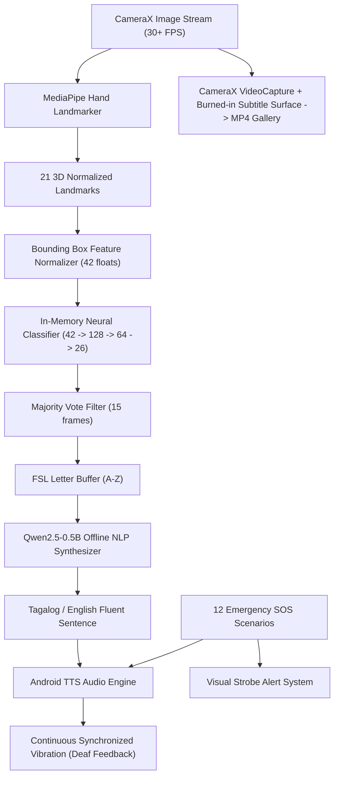

# iWani — Project Nexus
### On-Device Filipino Sign Language (FSL) Translation & Emergency Assistance System

[](https://developer.android.com/)
[](https://kotlinlang.org/)
[](https://developer.android.com/jetpack/compose)
[](https://developers.google.com/mediapipe)
[](#machine-learning-pipeline)
[](#nlp-engine-qwen25-05b-instruct)
[](https://www.icct.edu.ph/)

> **Project Nexus** is an accessible, 100% on-device assistive technology platform designed for Deaf, Hard of Hearing (HOH), and speech-impaired Filipinos. Developed by Computer Engineering students of **ICCT Colleges Foundation Inc.**, **iWani** bridges communication barriers through real-time 3D hand tracking, neural gesture recognition, offline bilingual Tagalog/English translation, live subtitled video recording, and one-tap emergency voice broadcast with synchronized Deaf haptic feedback.

---

## 📑 Table of Contents
1. [Key Features](#-key-features)
2. [Application Architecture](#-application-architecture)
3. [Machine Learning & Vision Pipeline](#-machine-learning--vision-pipeline)
4. [NLP Engine (Qwen2.5-0.5B-Instruct)](#-nlp-engine-qwen25-05b-instruct)
5. [Deaf Accessibility & Haptics](#-deaf-accessibility--haptics)
6. [Interactive Tutorial & Libraries.dev Visual FX](#-interactive-tutorial--librariesdev-visual-fx)
7. [Repository Structure](#-repository-structure)
8. [Prerequisites & Build Instructions](#-prerequisites--build-instructions)
9. [Team Hierarchy & Credits](#-team-hierarchy--credits)
10. [Contact & Inquiries](#-contact--inquiries)
11. [License & Acknowledgments](#-license--acknowledgments)

---

## 🚀 Key Features

### 1. Real-Time FSL 26-Letter Alphabet Classifier
* **MediaPipe 21-Joint 3D Hand Landmarks**: Real-time 30+ FPS hand skeleton tracking on both front (selfie) and rear cameras.
* **Compact Neural Engine**: Pure in-memory forward inference running in `< 0.05 ms` per frame on CPU with zero JNI overhead.
* **97.4% Test Accuracy**: Evaluated across 3,818 landmark coordinate samples covering all 26 letters (A–Z) of the Filipino Sign Language alphabet.
* **Configurable Letter Acceptance Speed**: User-adjustable recognition hold time (from 0.5s rapid recognition up to 4.0s for learners and beginners) with live progress bar feedback.
* **Temporal Stabilization & Filtering**: 15-frame temporal sliding window eliminates jitter and commits recognized letters cleanly into the word buffer.

### 2. Live Video Recording with Burned-In Subtitles
* **CameraX VideoCapture Integration**: Records high-definition video directly to public Android storage (`Movies/` or `DCIM/`).
* **Burned-In Subtitle Overlay**: Embeds live recognized FSL letters and translated sentences directly onto the video frames during recording, ensuring exported MP4 videos can be played anywhere with captions preserved.
* **Dynamic Camera Switching**: Seamless flip between front and rear cameras without tearing or stream dropped frames.

### 3. Qwen2.5-0.5B-Instruct Neural Translation
* **100% Offline On-Device LLM**: Runs quantized INT4 GGUF weights (~350 MB) locally via llama.cpp runtime with zero internet or cloud connection required.
* **Sign-to-Fluent Speech**: Transforms raw, telegraphic FSL gloss sequences (e.g., *"GURO TANONG"*) into fluent, grammatically natural Tagalog and English sentences (*"Excuse me po Ma'am/Sir, mayroon po sana akong tanong tungkol sa ating aralin."*).
* **Cultural Politeness**: Automatically injects respectful Filipino honorifics (*"po"*, *"opo"*).
* **Android Text-to-Speech (TTS)**: High-clarity speech synthesis for hearing conversation partners.

### 4. 12 Emergency SOS (Saklolo) Scenarios & Strobe Voice Broadcast
* **One-Tap Voice Broadcast**: Immediately announces loud emergency speech synthesis to alert surrounding people and authorities.
* **12 Pre-Configured Scenarios**:
  1. *Medical Emergency* (Emergency hospital care)
  2. *Police Assistance* (Crime / safety distress)
  3. *Fire Outbreak* (Immediate fire / smoke evacuation)
  4. *Transit / Lost* (Public transit guidance)
  5. *Accident / Injury* (Road or workspace trauma)
  6. *Earthquake / Disaster* (Natural disaster rescue)
  7. *Severe Allergic Reaction* (Breathing / anaphylaxis alert)
  8. *Elderly / PWD Fall* (Mobility assistance)
  9. *Choking / Cannot Breathe* (Immediate airway obstruction)
  10. *Robbery / Hold-Up in Progress* (Urgent police intervention)
  11. *Severe Bleeding* (First aid tourniquet request)
  12. *Lost Child / Missing Person* (Family reuniting broadcast)
* **Custom Emergency SOS Message**: Allows users to type and broadcast any specific situation with one click.
* **Deaf Alerting**: Visual strobe flashes on screen alongside continuous synchronized tactile vibration patterns.

### 5. Deaf Accessibility & Synchronized TTS Vibration
* **Continuous Haptic Speech Feedback**: Vibrates continuously in real time while the app is actively speaking TTS, and stops precisely when speech ends. This confirms to Deaf and HOH users that their message is actively being voiced aloud to listeners.
* **Physical Touch Haptics**: Subtle tactical clicks on all buttons, tabs, and category chips.
* **Eye-Relief Dual Theme**:
  * **ICCT Dark Mode**: Deep Midnight Navy (`#0A1120`), Slate Surface (`#131F37`), and Warm Gold (`#F59E0B`).
  * **Clean Light Mode**: Glare-free high-contrast aesthetic calibrated for bright outdoor sunlight.
* **Responsive Typography & Sliding Marquee**: Custom dynamic marquee scrolling (`.autoSlideIfOverflow()`) prevents text truncation on compact phone screens.

### 6. Blue Archive-Style Visual Novel Tutorial & Libraries.dev Visual FX
* **Interactive Storyline Tutorial**: 6-part episodic walkthrough featuring mascots **Grace** (Database Admin) and **Kian** (QA), with a special guest appearance by **Shouko Nishimiya** (*A Silent Voice*), guiding users step-by-step through FSL camera signing, emergency SOS, and on-device translation.
* **Libraries.dev Dynamic Effects Engine**:
  * **3D Rotating Neural Circuit Brain (Qwen)**: 3D rotating brain model with active synaptic light pulses and PCB trace animations.
  * **3D Rotating Molecular Structure (MediaPipe)**: Multi-colored rotating 3D atoms connected by structural bonds.
  * **Tri-Modal Day/Night Transitions**: Cycle between Wave Expansion, Iris Radial Wipe, and Split Curtain transitions without screen flicker.
  * **BorderBeam Glows & Status Badges**: Shimmering gold and cyan gradient highlights on active workspace cards and lead developer nameplates.

### 7. Interactive Team Avatar Showcase
* **Christmas-Light Sequential Rotation**: Automatically transitions team avatars every 3 seconds starting from Project Managers down through specialists.
* **Dual Presentation**: Displays crisp real profile portraits and custom-crafted chibi mascots dressed in unified iWani team uniforms.

---

## 🏛 Application Architecture



---

## 🧠 Machine Learning & Vision Pipeline

The Filipino Sign Language alphabet recognition model is trained on spatial 3D coordinate geometry:
1. **Feature Extraction (`ml/extract_landmarks.py`)**: Extracts 21 hand joints from video frames, computing normalized $(x, y)$ coordinate pairs relative to the detected hand bounding box.
2. **Neural Architecture**:
   * **Input Layer**: 42 normalized features (21 joints $\times$ 2 coordinates)
   * **Hidden Layer 1**: Dense 128 units with ReLU activation
   * **Hidden Layer 2**: Dense 64 units with ReLU activation
   * **Output Layer**: Dense 26 units with Softmax probability distribution
3. **Performance Metrics**:
   * **Accuracy**: **97.4%** test accuracy across all 26 FSL alphabet classes (A–Z).
   * **Inference Latency**: `< 0.05 ms` per frame on standard Android CPU cores with zero JNI overhead.
   * **Footprint**: Exported binary weights `fsl_weights.bin` (**61.8 KB**), ensuring zero cold-start delay.

---

## 💬 NLP Engine (Qwen2.5-0.5B-Instruct)

* **Architecture**: Qwen2.5 Transformer Language Model (0.5 Billion Parameters).
* **Quantization**: INT4 GGUF format (~350 MB total internal storage footprint).
* **Prompt Engineering**: Customized ChatML system prompts tuned for Filipino deaf-hearing colloquial dynamics:
  ```text
  <|im_start|>system
  You are iWani, an AI that converts Philippine Sign Language (FSL) glosses and quick words into natural, polite Tagalog and English sentences.
  <|im_end|>
  <|im_start|>user
  FSL Gloss: GURO TANONG
  <|im_end|>
  <|im_start|>assistant
  Tagalog: "Excuse me po Ma'am/Sir, mayroon po sana akong tanong tungkol sa ating aralin."
  <|im_end|>
  ```
* **Offline Storage Management**: Dedicated in-app Model Manager allows users to extract, verify, monitor, and clean the ~350 MB weight package directly from internal app storage.

---

## 📳 Deaf Accessibility & Haptics

Deaf and hard-of-hearing individuals cannot hear when an application is producing sound. To solve this, **iWani** implements a multi-sensory accessibility paradigm:

1. **Active Speech Vibration**: While Text-to-Speech is voicing an SOS broadcast or translated phrase, a rhythmic haptic pulse pattern runs continuously through Android's `Vibrator` service. Once the TTS engine fires `onDone()`, the vibration immediately stops.
2. **Visual Strobe**: High-contrast flashing amber/red overlays activate during emergency broadcasts.
3. **Scalable Typography & Sliding Marquee**: UI components automatically adjust between normal and enlarged font sizes, sliding long text smoothly via `.autoSlideIfOverflow()`.

---

## 🎨 Interactive Tutorial & Libraries.dev Visual FX

* **Interactive Storyline Tutorial**:
  * An interactive visual novel tutorial system guiding new users through iWani's capabilities.
  * Features dialogues with **Grace** and **Kian**, plus special guest **Shouko Nishimiya**.
* **Libraries.dev Dynamic Effects Suite**:
  * **Neural Circuit Brain Orb**: 3D rotating brain graphic for Qwen2.5 with live pulsing synaptic nodes.
  * **Molecular Structure Orb**: 3D multi-atomic molecular lattice for MediaPipe with smooth orbital rotation.
  * **Tri-Modal Day/Night Transitions**: Dynamic switching featuring Wave Expansion, Iris Radial Wipe, and Split Curtain.
  * **BorderBeam Glow**: Moving gradient borders on interactive cards and camera buttons.

---

## 📂 Repository Structure

```text
iWani/
├── app/                                        # Android Application Module
│   ├── src/main/
│   │   ├── java/com/projectnexus/iwani/
│   │   │   ├── MainActivity.kt                 # Root navigation, theme state, tri-modal transitions
│   │   │   ├── AppLanguage.kt                  # Bilingual EN / TL localization enum
│   │   │   ├── emergency/
│   │   │   │   ├── EmergencyPhrase.kt          # 12 Emergency SOS scenarios & definitions
│   │   │   │   └── EmergencySosManager.kt      # TTS audio engine & continuous Deaf haptic feedback
│   │   │   ├── ml/
│   │   │   │   ├── FslClassifier.kt            # In-memory neural forward engine (97.4% accuracy)
│   │   │   │   └── FslCameraAnalyzer.kt        # MediaPipe live stream frame analyzer
│   │   │   ├── nlp/
│   │   │   │   └── QwenFslTranslator.kt        # Qwen2.5 ChatML prompt & phrase synthesis
│   │   │   ├── ui/
│   │   │   │   ├── components/
│   │   │   │   │   ├── LibrariesDevEffects.kt  # 3D Brain & Molecule Orbs, BorderBeam, Marquee
│   │   │   │   │   ├── ChibiFaceAvatar.kt      # Sequential rotating profile & chibi avatar system
│   │   │   │   │   └── InteractiveTutorialDialog.kt # Blue Archive visual novel tutorial
│   │   │   │   ├── screens/
│   │   │   │   │   ├── HomeScreen.kt           # Bayanihan survey carousel, core workspaces
│   │   │   │   │   ├── FslCameraScreen.kt      # CameraX, gesture hold calibration, subtitled recording
│   │   │   │   │   ├── CommunicationScreen.kt  # Quick categories & Qwen neural translation
│   │   │   │   │   ├── EmergencySosScreen.kt   # 12-scenario Saklolo SOS broadcast
│   │   │   │   │   ├── AiModelManagerScreen.kt # On-device model weight manager (~350 MB)
│   │   │   │   │   └── AboutScreen.kt          # Team hierarchy, rotating avatars, contact inbox
│   │   │   │   ├── sound/
│   │   │   │   │   └── UiSoundManager.kt       # Tactile UI sound & haptic feedback controller
│   │   │   │   └── theme/
│   │   │   │       ├── Color.kt                # ICCT brand palette & eye-relief dark/light themes
│   │   │   │       └── Theme.kt                # Material 3 dynamic styling
│   │   ├── assets/
│   │   │   ├── hand_landmarker.task            # Google MediaPipe hand landmark model bundle
│   │   │   ├── fsl_weights.bin                 # Trained neural weights (61.8 KB)
│   │   │   └── fsl_wl_labels.json              # 26 FSL alphabet class definitions
│   │   ├── res/                                # Drawable resources, team photos, chibi mascots
│   │   └── AndroidManifest.xml                 # Camera, Audio, Storage, and Vibration permissions
│   └── build.gradle.kts                        # Android build configuration & dependencies
├── ml/                                         # Machine Learning Training Pipeline
│   ├── extract_landmarks.py                    # MediaPipe dataset landmark extractor
│   ├── train_alphabet_model.py                 # 3-layer neural network training script
│   └── data/
│       └── fsl_alphabet_landmarks.npz          # 3,818 landmark coordinate training samples
├── release/                                    # Distribution Packages
│   └── iWani-debug.apk                         # Pre-compiled Android installation package (~101 MB)
├── build.gradle.kts                            # Root project build configuration
├── settings.gradle.kts                         # Gradle project settings
├── gradlew / gradlew.bat                       # Gradle wrapper executables
├── LICENSE                                     # MIT License
└── README.md                                   # Comprehensive Project Documentation
```

---

## 🛠 Prerequisites & Build Instructions

### Prerequisites
* **Android Studio**: Ladybug / Hedgehog / Iguana (2023.2.1+)
* **Java Development Kit**: JDK 17 (recommended: Android Studio bundled JBR)
* **Android SDK**: Target API 34 (Android 14) with Minimum API 24 (Android 7.0)
* **Gradle**: Version 8.4 (bundled via Gradle Wrapper)

### Building the Debug APK
```bash
# 1. Clone the repository
git clone https://github.com/S1mplee67/iWani.git
cd iWani

# 2. Build on Linux / macOS
./gradlew assembleDebug

# 3. Build on Windows (PowerShell or Command Prompt)
.\gradlew.bat assembleDebug
```

The compiled APK will be output at:
`app/build/outputs/apk/debug/app-debug.apk`

---

## 👥 Team Hierarchy & Credits

### **ICCT Colleges Foundation Inc.**
**College of Engineering and Digital Technology**  
**Bachelor of Science in Computer Engineering (BSCpE)** — Academic Year 2026–2027

| # | Role | Member Name | Key Responsibilities |
|:---:|---|---|---|
| 1 | **Project Manager (Lead)** | **Lander John D. Cueto** | Overall project lifecycle, milestones, team coordination & presentation |
| 2 | **Frontend & Backend Developer (Lead)** | **Wency Miguel D. Valmonte** | Jetpack Compose UI architecture, CameraX video recording pipeline & burned-in subtitle renderer, Libraries.dev dynamic visual engine |
| 3 | **Lead Backend Developer (Lead)** | **Jhon Carlo A. Cunanan** | Real-time neural classifier, MediaPipe hand landmark extraction, spatial mathematical inference & TTS engine |
| 4 | **UI/UX Lead Designer (Lead)** | **Angel Andreian L. Alon** | Design system, high-contrast dark/light theme, responsive typography & Deaf user accessibility testing |
| 5 | **System Analyst** | **Justine Jay Arteche** | Functional analysis, SRS specifications, PWD accessibility compliance & architecture documentation |
| 6 | **Backend Developer** | **Dyle Jhoven E. Payla** | Qwen2.5 ChatML prompt engineering, bilingual gloss-to-sentence NLP pipeline |
| 7 | **Database Administrator** | **Mary Grace Ann N. Babagay** | Local storage schemas, SharedPreferences persistence & offline model asset management |
| 8 | **DevOps & Deployment Specialist** | **Leon B. Escaner** | Gradle multi-module build optimization, CI/CD pipeline & production APK generation |
| 9 | **Quality Assurance** | **Kian R. Cagadas** | Unit testing, 26-letter FSL recognition benchmarks, gesture edge-case verification |
| 10 | **Technical Writer & UML Architect** | **Milbert A. Lomibao** | Architectural diagrams, sequence flows, technical user documentation & project manual |
| 11 | **UAT Coordinator & Pitch Presenter** | **Brandon Ashley P. Lugay** | User Acceptance Testing (UAT), stakeholder presentation & field survey coordination |

---

## 📬 Contact & Inquiries

For inquiries, academic partnership, or feedback regarding Project Nexus and iWani:
* **Official Project Email**: [ascendens.projectnexus@gmail.com](mailto:ascendens.projectnexus@gmail.com)
* **GitHub Repository**: [https://github.com/S1mplee67/iWani](https://github.com/S1mplee67/iWani)

---

## 📄 License & Acknowledgments

This project is licensed under the **MIT License** — see the [LICENSE](LICENSE) file for details.

### Acknowledgments
* Special gratitude to the Filipino Deaf and Hard-of-Hearing community for their invaluable feedback on Filipino Sign Language (FSL) conventions.
* Faculty, Deans, and Mentors of the **College of Engineering and Digital Technology**, ICCT Colleges Foundation Inc.
* Google MediaPipe & Android Jetpack open-source teams for world-class mobile vision and declarative UI libraries.
